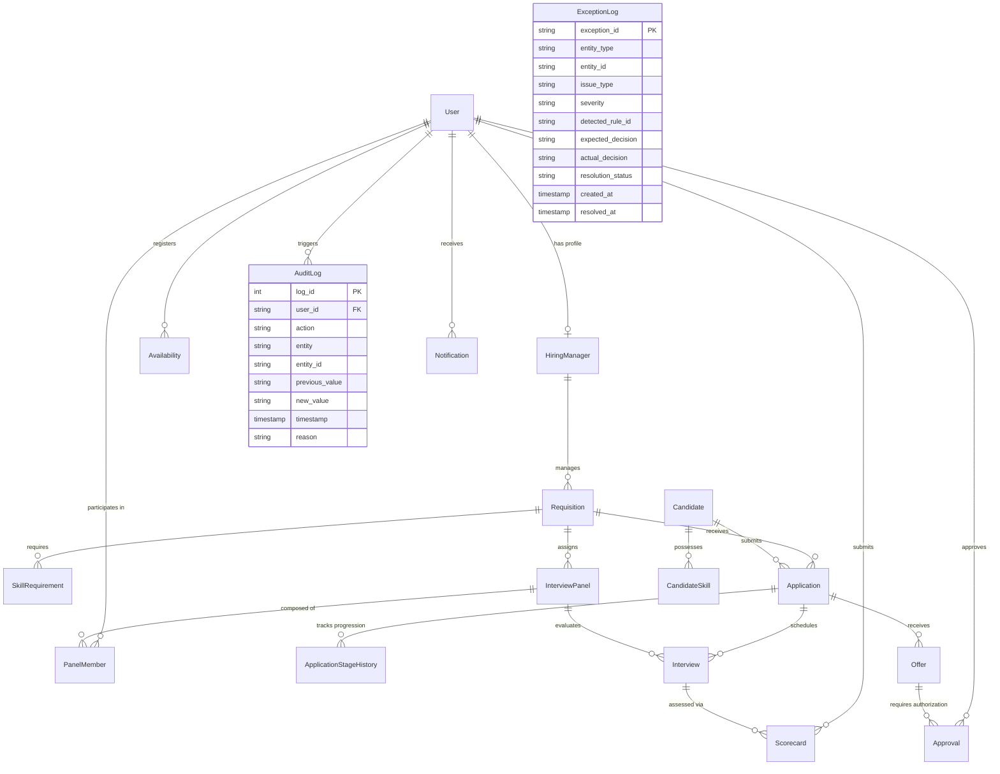

# TalentFlow 360 – Entity-Relationship (ER) Diagram

The following Mermaid ER Diagram models the complete relational architecture of the 18 entities in **TalentFlow 360**.

## Relationship Cardinalities
- **User to HiringManager**: 1-to-1 (Optional)
- **User to Availability**: 1-to-Many
- **User to Scorecard**: 1-to-Many
- **User to Approval**: 1-to-Many
- **Requisition to SkillRequirement**: 1-to-Many (Cascade delete)
- **Candidate to CandidateSkill**: 1-to-Many (Cascade delete)
- **Requisition & Candidate to Application**: Bridge relationship (`uq_candidate_requisition_app`)
- **Application to ApplicationStageHistory**: 1-to-Many (Append-only immutable audit trail)
- **Interview to Scorecard**: 1-to-Many (Unique constraint per reviewer per interview)
- **Offer to Approval**: 1-to-Many (Multi-level approvals: Level 1 Hiring Manager, Level 2 Executive HR for compensation exceptions)
